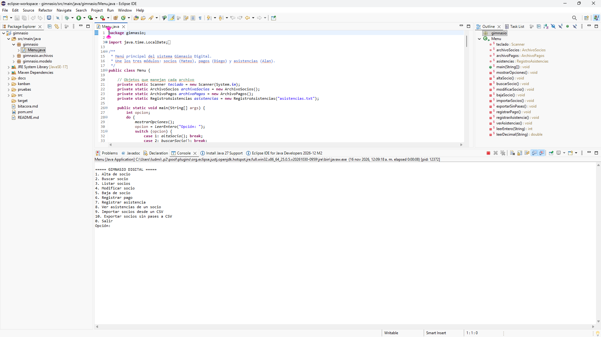
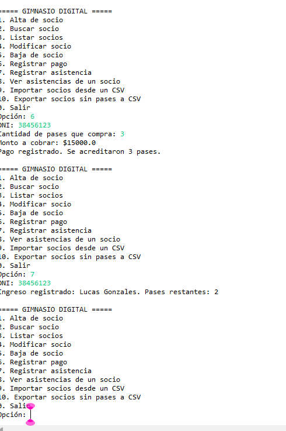
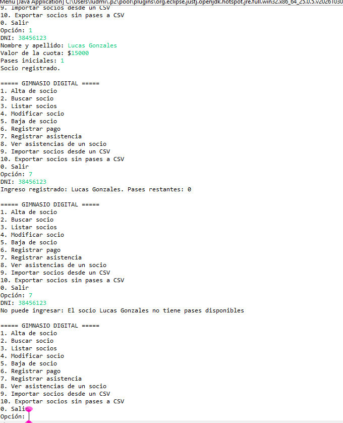
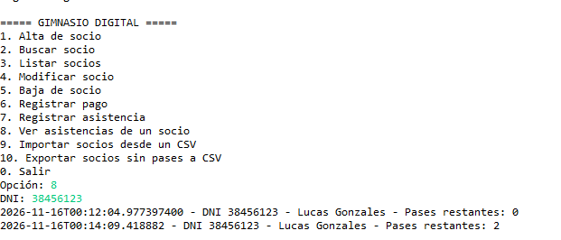
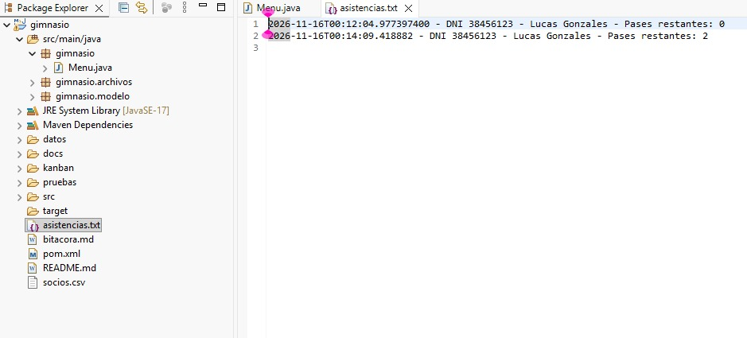

# Gimnasio Digital – Sistema de gestión de socios

**Materia:** Algoritmos y Estructuras de Datos 2 (AED2) – Prof. Silvina Burgos

**Integrantes:**
- Diego Altamirano – GitHub: @diegoaltamirano597-gif
- Pablo Mateo Aramayo – GitHub: @mateo1905-cab
- Alan Joel Pires – GitHub: @pires12334

**Tablero Kanban:** https://trello.com/b/ErUSUj3k/por-hacer

## Descripción del negocio
Gimnasio de barrio que vende pases a sus socios. Cada socio compra una cantidad de pases (ingresos o clases) y, cada vez que entra al gimnasio, se le descuenta uno.

## Problema que resuelve
Hoy el gimnasio anota socios, pagos e ingresos en un cuaderno o en planillas sueltas. Los datos se pierden o se duplican, no se sabe rápido cuántos pases le quedan a cada socio y no hay un registro confiable de asistencias ni de cobros.

El programa guarda toda la información en **archivos** (CSV y texto) para que los datos no se pierdan al cerrar el sistema y se puedan importar y exportar.

## Tema elegido
**Clase 10: Archivos de texto y CSV.**
Lo elegimos porque el problema principal del negocio es *guardar y recuperar información*: un gimnasio necesita conservar los datos de sus socios entre un día y el otro, y poder pasarlos a otras herramientas (por ejemplo, Excel) en formato CSV.

> Nota: al principio del proyecto habíamos elegido la Clase 8 con una clínica. El 11/11 cambiamos a la Clase 10 con un gimnasio (ver `bitacora.md`).

## Datos de cada socio
DNI, nombre, valor de la cuota, pases disponibles y fecha de vencimiento.

## Módulos y responsables
| Módulo | Responsable | Archivo |
|--------|-------------|---------|
| Socios (alta, consulta, modificación, baja y listado) con OpenCSV | Pablo Mateo Aramayo | `socios.csv` |
| Pagos y excepciones propias | Diego Altamirano | `movimientos.csv` |
| Asistencias y menú principal | Alan Joel Pires | `asistencias.txt` |

## Tecnologías
- Java 17
- Maven
- OpenCSV (lectura y escritura de CSV)
- java.io (FileWriter, FileReader, BufferedReader)
- Eclipse IDE

## Cómo ejecutar el proyecto
1. Clonar o descargar el repositorio.
2. En Eclipse: **File → Import → Maven → Existing Maven Projects** y elegir la carpeta del proyecto.
3. Esperar a que Maven descargue OpenCSV.
4. 4. Abrir `src/main/java/gimnasio/Menu.java` → clic derecho → **Run As → Java Application**.

## Funcionalidades
- Alta, consulta, modificación, baja y listado de socios en `socios.csv` (OpenCSV)
- Registro de pagos que acreditan pases al socio, guardados en `movimientos.csv`
- Registro de ingresos en `asistencias.txt`: valida que el socio tenga pases y descuenta uno
- Consulta del historial de asistencias de un socio
- Importar socios desde un CSV externo y exportar socios a CSV *(en desarrollo)*
- Manejo de errores con excepciones propias: socio duplicado, socio no encontrado y dato inválido (montos negativos, socio sin pases, formatos incorrectos)

## Capturas de pantalla

### Menú principal

### Registro de asistencia

### Socio sin pases (excepción DatoInvalido)

### Historial de asistencias

### Archivos generados (asistencias.txt y socios.csv)

## Pruebas realizadas
Ver la carpeta [`/pruebas`](pruebas): casos de prueba con datos de entrada, resultado esperado y resultado obtenido.

## Conclusiones
- Guardar los datos en archivos resolvió el problema principal del negocio: los socios, pagos y asistencias ya no se pierden al cerrar el programa.
- Usamos CSV con OpenCSV para los datos con columnas fijas (socios y pagos), porque se pueden abrir en Excel, y un archivo de texto simple para las asistencias, que es un registro que solo crece.
- Las excepciones propias (`DatoInvalido`, `SocioDuplicado`, `SocioNoEncontrado`) hacen que el programa avise el error y siga funcionando en vez de cerrarse.
- Lo más difícil fue coordinar el trabajo en grupo: al principio cada uno tenía su propia versión de la clase Socio y los packages no coincidían con las carpetas. Lo resolvimos unificando el análisis y trabajando siempre sobre la versión del repositorio.
- Mejoras posibles: no dejar entrar a socios con la cuota vencida y mostrar reportes de ingresos por mes.
